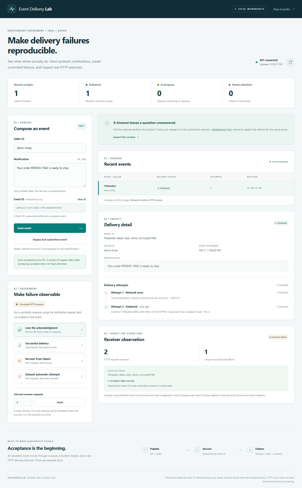

# Recorded experiments

These are controlled correctness experiments, not performance benchmarks or production usage metrics. All payloads are synthetic.

## Environment and commands

Local verification: October 7–21, 2026, Windows, Temurin JDK 17.0.19+10, Maven wrapper 3.9.16, Spring Boot 4.1.1, H2 2.5.250. Dashboard state tests and the optional MCP companion used Node 24.14.1. The Java application itself does not require Node.

```powershell
.\mvnw.cmd verify
node --test src/test/js/delivery-tracker.test.cjs
.\mvnw.cmd spring-boot:test-run@local-lab
```

On October 14, the Java suite passed 68 tests with zero failures, errors, or skipped tests. The six dashboard state tests passed. The [workflow](../.github/workflows/verify.yml) also checks Java 17 and 21, plus the dashboard state tests on Node 22.

## Lost acknowledgment: isolate the cause

[`lostAcknowledgmentRepeatsSideEffectUnlessReceiverDeduplicates`](../src/test/java/dev/sahreb/delivery/NotificationProcessorTest.java) runs against a real local HTTP server. Its first request performs the action, then withholds the acknowledgment until the sender times out. The processor retries the exact event.

| Receiver behavior | HTTP requests | Receiver side effects | Stored receipts |
| --- | ---: | ---: | ---: |
| Deliberately naive | 2 | 2 | 1 |
| Honors the idempotency key | 2 | 1 | 1 |

Both cases record `NETWORK_ERROR`, then `SUCCEEDED`. This demonstrates why one sender-side receipt is insufficient to prevent duplicate remote effects. The test invokes the processor retry directly to isolate this boundary; the integration suite separately exercises Kafka's retry policy.

## Browser experiment

The documented local command started the real embedded broker and dashboard. The **Lose the acknowledgment** button produced the following observations for synthetic event `f49aa442-888a-418c-843a-12712d187f05`:

- Two stored attempts: a timeout followed by HTTP 200 with `duplicate: true`.
- Two receiver requests, one receiver-side record matched to that event ID.
- Exact replay after success retained two attempts and one receiver effect.



The **Exhaust automatic attempts** drill produced three HTTP 503 attempts and `FAILED`. **Retry this event** then produced a fourth, successful HTTP attempt while preserving the previous three. The integration suite independently verifies that exhaustion retains the Kafka record in the dead-letter topic.

Keyboard activation of the failure drill worked. The layout was checked at the desktop viewport and a 390-pixel narrow viewport, with no horizontal page overflow. No browser console errors were observed during these checks. This is a manual usability check, not a comprehensive accessibility audit.

## What a harder test exposed

An early manual force-stop of the full application retained the receipt but lost its most recent pending-attempt row, even though the API had shown that row before termination. Graceful close/reopen tests had passed. Smaller isolated process-kill experiments did not reproduce the loss, so its precise cause remains unresolved.

The lab now explicitly asks H2 to `CHECKPOINT SYNC` after local commits, before proceeding to HTTP delivery or acknowledging successful processing. This adds a file-synchronization boundary; it is not a demonstrated diagnosis or complete fix for the earlier loss. A repeat against the earlier development database also lost a pending row after this change.

[`H2CrashDurabilityTest`](../src/test/java/dev/sahreb/delivery/H2CrashDurabilityTest.java) starts a separate writer JVM with six existing delivered events, records a new pending attempt, then forcibly terminates the writer while its connection pool remains open. Both tested configurations (`WRITE_DELAY=0` and `60000`) retained all seven receipts and the pending attempt. Startup reconciliation then marked the unfinished event `INTERRUPTED` without changing its unknown `PENDING` outcome. Separate failure-injection tests verify that retries cannot bypass a failed synchronization step.

Two consecutive full-application cycles using the documented Maven launcher and a fresh database then passed: the pending attempt survived forced termination, startup marked it `INTERRUPTED`, and explicit retry retained the old unknown attempt alongside a new successful one. Two additional cycles against a copy of the earlier database also passed. Every drill waited for its newly generated event ID to appear at the receiver before termination; an aggregate counter was not used as that signal.

The discrepancy remains unresolved. The passing experiments cover process termination under their tested conditions, not every crash timing, power failure, storage controller, or filesystem fault. Do not depend on this experimental lab as the sole audit record for real notifications. Investigating the earlier loss is follow-up work; the lost-acknowledgment comparison does not depend on a crash-safety claim.

The local broker lifecycle test also verifies real Kafka connectivity, loopback-only socket binding, released ports, and temporary-storage cleanup. The full launcher was checked at runtime: HTTP, broker, and controller listeners all used `127.0.0.1`.

## Automated full-application crash and recovery

On October 9, [`FullAppCrashRecoveryTest`](../src/test/java/dev/sahreb/delivery/FullAppCrashRecoveryTest.java) passed both on its own and in the full suite. It exercises the real `LocalLab` child process with Kafka, HTTP, and a fresh file database. The controlled crash window uses a 5-second receiver acknowledgment delay and a 30-second sender timeout; the application defaults are unchanged.

| Stage | Observed and asserted |
| --- | --- |
| Before termination | Six completed events; the seventh event's exact ID observed at the receiver, with one `PENDING` sender attempt |
| Database copy inspected before restart | All seven receipts and attempts retained; pending attempt fields matched the pre-kill API observation |
| Fresh launcher and broker | Target became `INTERRUPTED`; receipt and unknown attempt were unchanged; six completed events were unchanged |
| Explicit retry | `DELIVERED`, with the old `PENDING` attempt plus one new `SUCCEEDED` attempt |

The receiver starts empty after restart and performs a second effect for the target event across the two process lifetimes. This makes its volatile deduplication limit observable. A negative control temporarily removed startup reconciliation: the test failed because the event remained `DELIVERING` instead of becoming `INTERRUPTED`. The call was restored before the passing full suite.

The [focused command and evidence locations](failure-drills.md#force-stop-the-full-application) let another developer repeat the check or inspect a failed run. These results add a reproducible full-path regression; they do not resolve the earlier anomaly or establish power-loss safety.

## Read-only dead-letter inspection

On October 12, the focused inspector and Kafka integration suites passed 23 checks, followed by the full 67-test Java suite. Real Kafka integration runs produced inspectable HTTP-exhaustion, conflicting-payload, and malformed-JSON dead letters. The API returned the retained payload preview, application exception type, and source record coordinates; the malformed event remained absent from receipt storage.

Repeated HTTP inspection preserved the delivery group's committed offsets, consumer-group inventory, receipt count, and stored delivery history. After explicit retry succeeded, the original dead-letter item remained inspectable. An unknown event ID returned an empty snapshot, with the searched window still visible. Invalid query values returned `400`.

Controlled consumer fixtures separately verified the latest-100-offset window, retention gaps, newest-match limits, exclusion of later appends, bounded previews, malformed headers, incomplete scans and broker failures returning `503`, and concurrent inspection returning `429`. Those fixtures are not a measurement of broker-outage latency. The scan budget covers Kafka operations rather than promising an absolute HTTP wall-clock deadline.

Reproduce with the [API drill](failure-drills.md#inspect-dead-letters-without-advancing-consumer-offsets) or `./mvnw "-Dtest=DeadLetterInspectorTest,DeliveryIntegrationTest" test` (PowerShell: `.\mvnw.cmd "-Dtest=DeadLetterInspectorTest,DeliveryIntegrationTest" test`). These results cover the lab's single-partition, synthetic-data setup; they do not establish complete history, a production audit service, or multi-partition support.

## Stalled Kafka connection and diagnostic recovery

On October 14, [`DeadLetterNetworkFailureTest`](../src/test/java/dev/sahreb/delivery/DeadLetterNetworkFailureTest.java) used the production constructor with a real Kafka client against an owned loopback TCP peer that read a complete Kafka request but never replied. The factory supplied 60-second timeouts; the inspector applied its three-second budget.

| Focused local run | Observed and asserted |
| --- | --- |
| Query while the first inspection was stalled | `429` |
| Stalled inspection | Generic `503` in 3,129 ms; no successful empty snapshot or exception details |
| Before fixture cleanup | Peer observed the client close its connection |
| Same inspector pointed at a healthy embedded broker | `200` with the seeded synthetic dead letter |

A negative control temporarily changed the inspector's timeout to 30 seconds. The test failed at its six-second future wait, then cleaned up the stalled request and sockets. The original source was restored before full verification. This shows the check detects a materially longer wait; the observed timing is not a performance benchmark.

MockMvc exercises the controller and error mapping; the Kafka network transport is real. The experiment covers a peer that stalls negotiation/metadata, not every broker outage or a hard HTTP, DNS, TLS, or JVM deadline. The [focused drill](failure-drills.md#simulate-a-stalled-broker-connection) documents rerunning it and locating its JSON evidence in local and CI test artifacts.

## Guided walkthrough on a reused demo

On October 16, the [three-stop walkthrough](walkthrough.md) was checked in the browser against the real local launcher, with a separate test database. One successful event was sent first so the counters were not zero. The lost-acknowledgment event then showed `NETWORK_ERROR`, `SUCCEEDED`, and one matching receiver record: process totals rose from 1 request / 1 effect to 3 requests / 2 effects. Exact replay left the two attempts and those totals unchanged; this UI observation alone does not prove that Kafka consumed the replay.

A second scenario exhausted three HTTP `503` attempts. Both documented GET command forms returned its dead letter; repeated inspection left the stored event unchanged. Manual retry appended a fourth, `SUCCEEDED` attempt, preserving the original three and the dead letter at offset 0. The selected detail UUID differed from the composer's next-event UUID, as the walkthrough explains. No browser warnings or errors were observed. This manual check covers the stated path, not all UI interactions or accessibility behavior.

After stopping the launcher, the two naive-versus-idempotent cases and all twelve Kafka integration cases passed. These independently exercise the comparison, consumed replay, and inspection/recovery claims linked from the walkthrough.

## Read-only MCP event diagnostics

On October 19, the [MCP companion](../diagnostics/README.md) was checked against the real local Java/Kafka launcher and an isolated database. Synthetic event `3c9aa7e6-1c1a-4b2f-ae32-a8f74a2f0abb` produced `NETWORK_ERROR`, then `SUCCEEDED`. A real MCP stdio call returned both sender attempts; a limit of one returned only the successful attempt, with `totalAttempts: 2` and `attemptsTruncated: true`. Repeated MCP reads left the API's event history and receiver state unchanged.

A missing UUID returned `not_recorded` with the asynchronous-consumption caveat. After the launcher stopped, the client returned `unavailable` and exited with failure. Eight automated companion tests passed, including real stdio discovery/calls, HTTP failure fixtures, a stalled response body that timed out in about three seconds, and subsequent recovery. These checks establish the tested read path, not model reasoning quality, tenant isolation, or receiver-side completion.

## MCP cancellation across the protocol boundary

On October 21, the [protocol recovery check](../diagnostics/README.md#check-cancellation-through-mcp) exercised the production stdio process with a real SDK client and an owned HTTP peer. A stalled response body produced an MCP error result with `TIMEOUT` in about three seconds, without returning partial upstream data. The peer observed the timed-out response close while the process remained available to MCP ping.

Four additional stalled calls filled the admission limit; the fifth returned `BUSY` without another HTTP request. Cancelling the four MCP calls rejected their client promises and closed all four HTTP responses before fixture cleanup. Four fresh calls were then admitted simultaneously and returned validated results. Holding their responses until all four arrived prevents sequential success from masking a leaked slot.

A negative control temporarily removed forwarding of the MCP cancellation signal. Client calls still rejected, but the test failed because the HTTP responses did not close within its observation guard. The source was restored before passing checks. All nine companion tests passed. This verifies the tested cancellation path, not a general distributed-cancellation guarantee; the peer is a controlled HTTP fixture rather than the Java/Kafka service.

## Interpretation

The controlled receiver's deduplication map is in memory. A restart resets it. HTTP success confirms a response, not downstream business completion. The embedded broker also starts fresh on every run. See the [architecture and crash windows](architecture.md) and [failure drills](failure-drills.md) for the limits of each observation.
