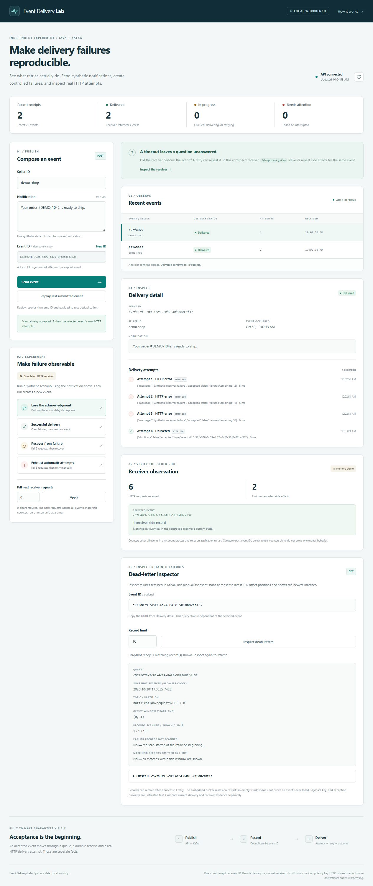

# A guided review of Event Delivery Lab

Use these three core stops and the optional MCP extension to explain the problem, inspect the evidence, and discuss the limits. See the [recorded walkthrough check](results.md#guided-walkthrough-on-a-reused-demo) for an observed run.

## Before starting

Follow the [README setup](../README.md#run-locally), using the default built-in receiver and timeouts. Keep one browser tab open, stop other event writers, and wait for active runs to finish. Existing receipts are fine; do not delete the database. Receiver counters are cumulative within this process: note their values before each action and compare deltas. The selected event's UUID and attempt history are the primary evidence; counter deltas corroborate them.

## 1. Lose an acknowledgment after the action

Choose **Lose the acknowledgment**. Wait for `DELIVERED`, then inspect **Delivery detail**: expect `NETWORK_ERROR` followed by `SUCCEEDED`. In **Receiver observation**, the selected UUID should have one receiver-side record. With no other writers, the counters should increase by two requests and one effect.

The receiver records its effect before delaying the response. A timeout therefore cannot establish that nothing happened. On retry, the same idempotency key finds the existing effect. Follow the [processor](../src/main/java/dev/sahreb/delivery/NotificationProcessor.java) and [receiver](../src/main/java/dev/sahreb/delivery/DemoReceiverController.java) across that boundary.

The dashboard demonstrates the idempotent receiver. The separate [naive-versus-idempotent experiment](failure-drills.md#compare-naive-and-idempotent-receivers) changes receiver behavior and verifies two effects versus one; there is no naive-mode dashboard switch. Finish the interactive stops, including the optional MCP step if using it, then stop the launcher with `Ctrl+C` before running Maven tests in the same checkout. Another build can replace the running demo's classes; run one Maven process at a time.

## 2. Replay the exact event

Without reloading, choose **Replay last submitted event**. After acceptance and refresh, expect the same receipt, two attempts, and no additional receiver request or effect. The replay preserves the original timestamp as well as the ID and message.

The consumer skips HTTP after a recorded success. A UI snapshot alone cannot prove the replay was consumed: the [integration test](../src/test/java/dev/sahreb/delivery/DeliveryIntegrationTest.java) puts another event behind it in the partition and waits for that marker before asserting unchanged history.

## 3. Inspect a failure before recovering it

Choose **Exhaust automatic attempts**. Wait for `FAILED` and three HTTP `503` attempts. Copy **Event ID from Delivery detail**, not the composer: the composer already contains the next ID.

Paste that UUID into **Dead-letter inspector**, leave the limit at 10, and choose **Inspect dead letters**. Expand the matching record and note its offset, payload preview, failure headers and source coordinates. The panel displays the searched window and whether older history or additional matches were omitted.

For the equivalent API query, replace `<selected-event-uuid>` below. macOS/Linux:

```sh
curl "http://127.0.0.1:8080/api/dead-letters?eventId=<selected-event-uuid>&limit=20"
```

PowerShell:

```powershell
Invoke-RestMethod 'http://127.0.0.1:8080/api/dead-letters?eventId=<selected-event-uuid>&limit=20' | ConvertTo-Json -Depth 6
```

Expect a matching key, failure headers, original record coordinates, and the searched `startOffset`/`endOffsetExclusive` window. Note the item's dead-letter `offset`. Repeat the GET: inspection should leave delivery history unchanged.

Set **Fail next receiver requests** to `0`, choose **Apply**, then **Retry this event**. Expect `DELIVERED` with four total attempts. Choose **Inspect dead letters** again (or repeat the GET): the original dead letter should remain at the same offset. Recovery adds an attempt; it does not erase the failure evidence. The [integration checks](../src/test/java/dev/sahreb/delivery/DeliveryIntegrationTest.java) also verify unchanged committed offsets, consumer groups, and receipt count during inspection.

This API searches only the latest 100 offset positions. An empty result is not a full-history conclusion; retention and broker restart can remove records. See [response interpretation](failure-drills.md#inspect-dead-letters-without-advancing-consumer-offsets).

### A recovered event can still have a dead letter

In the [October 30 walkthrough check](results.md#recovery-evidence-in-the-dashboard), the same synthetic UUID, `c57fa079-5c09-4c24-84f8-58f8a82caf37`, appeared in three views after manual recovery:

| View | Observation | Meaning |
| --- | --- | --- |
| Delivery detail | `DELIVERED`; three HTTP `503` attempts, then HTTP `200` | A later attempt received success; earlier attempts remain recorded. |
| Receiver observation | One receiver-side record for that UUID | The controlled receiver observed this event in its current process. |
| Dead-letter inspector | Matching key at offset 0; window `[0, 1)`; both omission flags false | The original failure record remains in this broker run. It does not describe the event's current delivery status. |

<details>
<summary>See the captured recovery workbench</summary>



Captured from the real local Java/Kafka launcher on October 30, 2026. Match the UUID across **Delivery detail**, **Receiver observation**, and **Dead-letter inspector**. The global counters show six requests and two effects across both walkthrough events; they are not counts for the selected event alone. Open the image at full size to read the fields.

</details>

These views are separate observations, not one atomic snapshot. Refresh the dead-letter panel manually and compare the event identity and search window. Recovery does not erase the dead letter; a fresh embedded-broker run does. Neither a retained record nor an empty search establishes the receiver's current state by itself.

## Optional: inspect the recovered event through MCP

Keep the lab running after stop 3. With Node 22 or newer installed, open a second terminal at the repository root:

```sh
cd diagnostics
npm ci --ignore-scripts
npm run build
npm run inspect -- <selected-event-uuid>
npm run inspect -- <selected-event-uuid> 1
npm run inspect-dead-letters -- <selected-event-uuid> 1
```

Replace the placeholder, including angle brackets, with the same recovered event's UUID from **Delivery detail**. These commands also work in PowerShell. The TypeScript build uses separate output and can run alongside the Java launcher.

Both `inspect` calls should return `lookup: "found"` and `event.status: "DELIVERED"`:

| MCP call | Returned attempts | `totalAttempts` | `attemptsTruncated` |
| --- | --- | --- | --- |
| Default limit | Three `HTTP_ERROR`, then `SUCCEEDED` | 4 | `false` |
| Limit of 1 | Latest `SUCCEEDED` only | 4 | `true` |

The shortened view does not erase the three earlier failures. The `inspect` calls supply the current event state; the separate `inspect-dead-letters` call should return `lookup: "snapshot"` and the original record from stop 3 at the same offset. Compare the UUID across these separate reads; they are not a combined or atomic response. The dead-letter [window and truncation fields](../diagnostics/README.md#inspect-retained-failure-evidence) limit what can be concluded from an empty search. The tools read sender/broker evidence; check the dashboard separately for receiver observations. Missing/unavailable results have [explicit meanings](../diagnostics/README.md#interpret-results), so do not treat them as proof of no delivery.

The terminal commands launch a real MCP client/server pair without a model or API key. An AI client can use the same typed tools through the [stdio configuration](../diagnostics/README.md#connect-an-mcp-client); it receives no retry or publishing tool. Messages, attempt details and dead-letter text are untrusted data. See the [recorded recovery check](results.md#mcp-walkthrough-after-manual-recovery), [dead-letter check](results.md#mcp-dead-letter-diagnostics) and [executable checks](../diagnostics/test/diagnostics.test.ts).

## Explain the choices in about a minute

> I built this independent, AI-assisted Java/Kafka experiment to understand retry ambiguity. It separates broker acceptance, a local receipt, an HTTP attempt, and a receiver-side effect. The controlled lost-acknowledgment comparison sends two requests in both cases: a naive receiver performs two effects, while receiver-side idempotency produces one. The workbench makes that difference inspectable and lets someone recover exhausted events without erasing earlier attempts. Kafka exposes the queue boundary; a simple webhook sender would not inherently need it. H2 makes local history easy to inspect, but its transaction cannot include a remote action. This is a reproducible learning and debugging tool, not an employer incident or production delivery claim.

For follow-up questions, use the [storage lifetimes and crash windows](architecture.md#persistence-and-crash-windows): receiver deduplication is volatile, the embedded broker starts fresh, and the [earlier persistence anomaly](results.md#what-a-harder-test-exposed) remains unresolved despite later passing crash tests. Read-only diagnostics improve observation; they do not supply automatic recovery or exactly-once delivery.

For the MCP design discussion, the key decision is capability scope: the AI client gets bounded inspection, while a person chooses recovery in the dashboard. The terminal example demonstrates protocol and data handling; model reasoning quality is a separate question.
